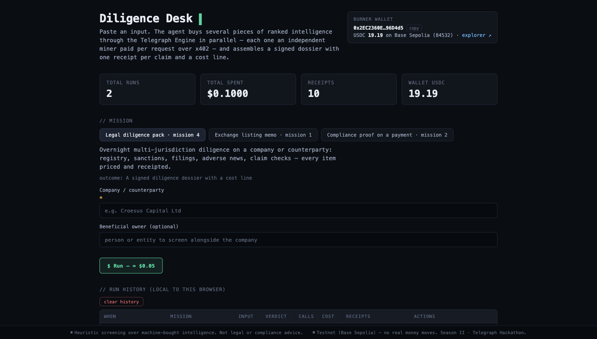

# Diligence Desk

**Autonomous diligence agents that buy their own intelligence — and show the receipts.**

[](https://diligence-desk-chi.vercel.app)
[](https://nextjs.org)
[](https://www.typescriptlang.org)
[](https://x402.org)
[](https://sepolia.basescan.org)
[](https://hackathon.telegraphprotocol.com)

**Live demo:** **https://diligence-desk-chi.vercel.app** — paste a company, press **`$ Run — ≈ $0.05`**, and inspect every paid call behind the verdict.



One input → several **paid** information requests in parallel through the
[Telegraph Engine](https://hackathon.telegraphprotocol.com) → each request goes to an
independent miner paid per call over **x402** (HTTP-native USDC micropayments) → a signed
**diligence dossier** with a verdict, one on-chain receipt per claim, and a cost line.

> **Testnet only.** Base Sepolia USDC. No real money moves. The verdict layer is a
> deterministic screening heuristic, not legal or compliance advice.

---

## Contents

- [Why this exists](#why-this-exists)
- [What you get](#what-you-get)
- [Missions](#missions)
- [How it works](#how-it-works)
- [Evidence](#evidence)
- [Run it locally](#run-it-locally)
- [Configuration](#configuration)
- [Project structure](#project-structure)
- [Design decisions](#design-decisions)
- [Limits and safety](#limits-and-safety)
- [Hackathon](#hackathon)
- [License](#license)

---

## Why this exists

Diligence is not one question. It is a stack of small, independent questions: Is the company
registered? Is it sanctioned? Has it filed what it should? Is there adverse news? Are its own
claims true? Today you either trust a dashboard you cannot audit, or pay a retainer for a
memo you cannot reproduce.

Diligence Desk treats each question as a **priced purchase**. The agent discovers specialist
miners, pays each one for one answer, records the signal hash and the settlement receipt, and
assembles the answers into a dossier a human can review. The verdict is deterministic; the
evidence is raw; the cost is visible line by line.

## What you get

- **A verdict with a reason** — `CLEAR`, `REVIEW`, `BLOCK`, or `INCOMPLETE`, built from
  structural checks over the miners' raw JSON, with the excerpt beside every status.
- **One receipt per claim** — `signal_hash`, payer, miner, amount, epoch, and Base Sepolia
  `tx_hash`, captured from the x402 settlement.
- **A cost line** — every call is priced; the dossier reports total requests, total spend, and
  the wallet that paid.
- **Reproducibility** — the same input can be rerun, and each stored signal hash can be fetched
  again from the engine's free verification endpoint.
- **A local run history** — the dashboard keeps past runs and a receipt ledger in the browser,
  and can verify receipts against the chain in a batch.

## Missions

The project covers three Telegraph hackathon missions. All three run end-to-end and have
committed evidence.

| Mission | Input | What the agent buys | Output |
|---|---|---|---|
| **04 · Legal diligence** *(primary)* | Company, optional beneficial owner | Corporate registry, sanctions, statutory filings, adverse news, claim verification | Signed diligence dossier |
| **01 · Exchange listing** | Token contract, ticker, optional treasury wallet and social handle | Contract audit, holder concentration, social authenticity, treasury sanctions, on-chain sanity | Listing risk memo |
| **02 · Stablecoin compliance** | Payee, amount, optional wallet and token | Sanctions, counterparty registry, payment fraud risk, reserve attestation | Payment-attached compliance proof |

### 04 · Legal diligence pack

Five parallel buys: `CORPORATE_REGISTRY_LOOKUP`, `SANCTIONS_SCREENING_MATCH`,
`REGULATORY_FILING_MONITOR`, `WEB_SEARCH`, and `FACT_CHECK`. The result is **CLEAR** for a
clean company and **BLOCK** when a check hard-fails. Every step keeps its raw miner output, so
a reviewer can see the evidence behind the verdict instead of trusting a summary.

### 01 · Exchange listing memo

Token contract in, listing risk memo out. Contract audit via **GoPlus**, holder distribution
via **ChainSight/Blockscout**, supply and verification status, treasury sanctions screen, and
an on-chain sanity read.

### 02 · Stablecoin payment compliance

A payment that carries its own compliance proof: sanctions screen, counterparty registry
check, fraud-risk score, and a reserve attestation request.

### Flagship demo: Tornado Cash

Screening *Tornado Cash* returns `on_list: 0` — the agent reflects the **March 2025 OFAC
delisting** in real time — while the fraud miner still returns a high risk score (65% in the
stored run). Verdict: **BLOCK**. Fresh lists beat stale lore, and the dossier shows both facts
side by side.

## How it works

```text
input
  │
  ▼
mission config (lib/intents.ts)
  │   5 queries built from templates
  ▼
purchase strategy (lib/telegraph.ts)              spending guards (lib/limits.ts)
  │
  ├─ 1. FREE discovery: GET /engine/v1/intents/{intent}/miners       (cached 10 min)
  ├─ 2. DETERMINISTIC direct-ask to pinned specialists:
  │      POST /engine/v1/ask/{minerId}  { query, method, endpoint, payload }
  │      payload filled from run input — no LLM in the direct path
  ├─ 3. FALLBACK: LLM router POST /engine/v1/ask (+ one intent-hint retry)
  │      a settled-but-errored call is NEVER re-paid
  ▼
x402 exact: sign EIP-3009 → facilitator settles USDC → miner answers
  ▼
verdict (lib/verdict.ts): deterministic, structural-first heuristics per miner shape
  ▼
dossier: verdict + steps (raw excerpts, reasoning, receipts) + cost line
```

**The purchase path is deterministic.** The Engine's LLM router misroutes generic-word
intents — "audit" can land on an academic-paper miner. So specialists are pinned via free
discovery and structured payloads, then verified live; the router is only a fallback. Every
step shows its route provenance (`direct:goplus-security` vs `router`).

**The verdict layer is deterministic.** Miner JSON echoes the query text and contains
*negative* fields (`"honeypot_with_same_creator":"0"`), so keyword regexes alone false-positive.
The heuristic reads named fields first (`is_honeypot`, `on_list`, `holders`, `verdict`), then
falls back to language, and never claims `CLEAR` without a positive signal.

**The receipt is the product.** Every claim maps to a `signal_hash`; the free
`GET /engine/v1/signal/{hash}` endpoint returns the exact evidence the node settled on, and the
Base Sepolia transaction is the payment record.

## Evidence

All artifacts are committed under [`evidence/`](evidence/). They are testnet runs; the wallet
and receipts are public on Base Sepolia.

| Artifact | What it proves |
|---|---|
| [`evidence/first-call.json`](evidence/first-call.json) | First paid call: `SANCTIONS_SCREENING_MATCH`, $0.01, epoch 441, tx `0xdeedd7a8…` |
| [`evidence/legal-run-clean.json`](evidence/legal-run-clean.json) | Legal dossier: **CLEAR**, 5/5 receipts, $0.05 |
| [`evidence/exchange-run.json`](evidence/exchange-run.json) | Exchange memo: **CLEAR**, 3/3 receipts, all direct specialists, $0.03 |
| [`evidence/stablecoin-run.json`](evidence/stablecoin-run.json) | Compliance proof: **BLOCK** (fraud 65%), 4/4 receipts, $0.04 |
| [`docs/screenshots/dash-top.png`](docs/screenshots/dash-top.png) | Dashboard, missions, run history |
| [`docs/screenshots/dash-full.png`](docs/screenshots/dash-full.png) | Full dashboard with the receipt ledger browser |

Verify any signal hash directly:

```bash
curl "https://devnode.telegraphprotocol.com/engine/v1/signal/<signal_hash>"
```

## Run it locally

**Prerequisites:** Node.js 20+ (the x402 client uses WebCrypto), npm, and a browser wallet is
*not* required — the app uses a server-side burner key.

```bash
git clone https://github.com/praneshnikhar/diligence-desk.git
cd diligence-desk
npm install

# 1. create a burner wallet (writes .env.local, mode 0600, gitignored)
npm run new-wallet

# 2. fund it with testnet USDC (free):
#    https://faucet.circle.com  → USDC → Base Sepolia → paste the printed address
#    20 USDC per request, per wallet, per 2 hours

# 3. build and run
npm run build && npm start
# → http://localhost:3000
```

Optional smoke test — one real paid call, saved to `evidence/first-call.json`:

```bash
node scripts/smoke-test.mjs
node scripts/verify-owner.mjs   # prints the derived address, never the key
```

For development, `npm run dev` starts the Next.js dev server.

## Configuration

Create `.env.local` (never commit it). `npm run new-wallet` writes the first variable for you.

| Variable | Required | Default | Purpose |
|---|---|---|---|
| `TELEGRAPH_EVM_PRIVATE_KEY` | Yes | — | Burner key used to sign x402 payments. Testnet only. |
| `TELEGRAPH_NODE_URL` | No | `https://devnode.telegraphprotocol.com` | Telegraph node/engine base URL. |
| `TELEGRAPH_ENGINE_URL` | No | `https://devnode.telegraphprotocol.com/engine` | Engine URL used by the smoke-test script. |

Hard guards are in [`lib/limits.ts`](lib/limits.ts) and are enforced before dispatch:

| Guard | Value |
|---|---|
| Max calls per run | 12 |
| Max spend per run | $0.25 |
| Per-call price ceiling | $0.05 |
| Per-call timeout | 45 s |

## Project structure

```text
diligence-desk/
├── app/
│   ├── page.tsx                 # dashboard: missions, run history, receipt ledger
│   └── api/
│       ├── run/route.ts         # mission orchestration + paid calls
│       ├── wallet/route.ts      # burner wallet address + testnet balances
│       └── receipt/[hash]/route.ts
├── lib/
│   ├── intents.ts               # mission definitions and query builders
│   ├── telegraph.ts             # discovery, direct-ask, router fallback, x402 client
│   ├── verdict.ts               # deterministic screening heuristics
│   ├── limits.ts                # spend and call caps
│   ├── ledger.ts                # per-run receipt ledger
│   └── runStore.ts              # browser-local run history
├── scripts/
│   ├── new-wallet.mjs           # burner key → .env.local
│   ├── smoke-test.mjs           # one paid call, evidence capture
│   └── verify-owner.mjs         # derive address without printing the key
├── evidence/                    # committed testnet receipts and dossiers
├── docs/screenshots/            # dashboard screenshots
└── .env.example                 # copy to .env.local
```

## Design decisions

1. **Deterministic purchase path.** Pin the specialist; use the LLM router only as a fallback.
   Free discovery plus structured payloads beat generic routing, and route provenance is visible.
2. **Structural-first verdicts.** Read named JSON fields before language. Miner output echoes the
   query and contains negative fields, so regex-only screening is unsafe.
3. **Epistemic honesty as a feature.** An LLM fact-checker can cite stale enforcement lore. The
   fact-check step therefore verifies a present-tense legitimacy claim that cannot be stale, while
   fresh enforcement news is the live web-search step's job.
4. **Receipts are the product.** Every claim is traceable to a signal hash and a settled payment,
   not to a paragraph in a model's answer.

## Limits and safety

- **Testnet only.** Base Sepolia (eip155:84532), Circle faucet USDC. The burner key holds nothing
  of value.
- **No real money.** x402 `exact` uses EIP-3009 authorization; the facilitator submits the transfer,
  so the payer needs no ETH for gas.
- **Caps are enforced in code.** 12 calls, $0.25 per run, $0.05 per call, 45 s timeout. A
  settled-but-errored call is never re-paid.
- **Not advice.** The verdict is a screening heuristic over machine-bought intelligence. It is not
  legal, financial, or compliance advice, and it can be wrong.
- **Raw evidence, not hidden reasoning.** Every step exposes the miner's raw excerpt and route; a
  human makes the final call.

## Hackathon

Built for **Telegraph Hackathon Season II** (1 Nov → 1 Dec 2026), **Apps & Agents** track.
Mission coverage: **04 Legal diligence** (primary), **01 Exchange listing memo**, and
**02 Stablecoin payment compliance**.

- Live deployment: https://diligence-desk-chi.vercel.app
- Engine: https://devnode.telegraphprotocol.com/engine
- Hackathon: https://hackathon.telegraphprotocol.com

## License

No open-source license has been chosen yet. The repository is public for review and hackathon
judging; please contact the author before reusing the code.

## Credits

Built with [Telegraph Protocol](https://hackathon.telegraphprotocol.com), [x402](https://x402.org),
[viem](https://viem.sh), [Next.js](https://nextjs.org), and testnet USDC from the
[Circle faucet](https://faucet.circle.com). Deployed on [Vercel](https://vercel.com).
Not affiliated with or endorsed by any of these projects.
